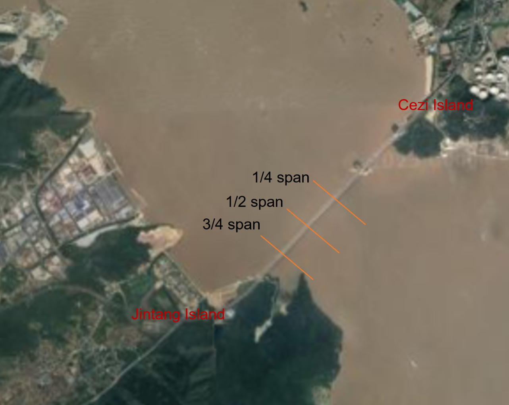
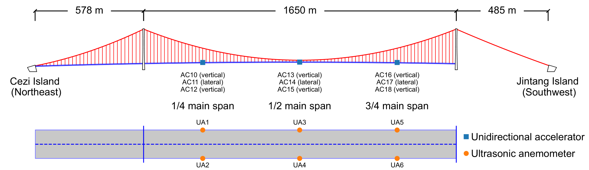

# 桥梁涡振中的风速与加速度时程

[快速开始](#快速开始) · [English version](#wind-and-acceleration-time-histories-during-bridge-vortex-induced-vibration)

本仓库提供一座大跨桥梁的一场候选涡激振动（VIV，简称涡振）事件。风速和主梁加速度按十分钟配对保存，可沿同一时间轴观察风场变化、比较桥面两侧的振幅，并跟踪振动的增长与衰减。

## 桥梁与监测背景

监测对象是一座跨海大跨度悬索桥，主跨1650m，主梁采用分离双箱梁。

<p align="center">
  <a href="figures/site-terrain.png"></a><br>
  <em>图 1　桥址地形与监测截面。橙线标出主跨的四分之一、跨中和四分之三处。</em>
</p>

### 风速传感器布置

沿主跨设四分之一跨、跨中和四分之三跨三个测风截面（图 2 下图）。每个截面在桥面两侧的照明灯杆上各安装一台 Young 8100 型三维超声风速仪。四分之一跨的两台仪器为 UA1 和 UA2，跨中为 UA3 和 UA4，四分之三跨为 UA5 和 UA6。每台仪器记录西向（`x`）、北向（`y`）和竖向（`z`）三个风速分量，单位为 m/s。

探头高于桥面，以减小桥面绕流对风速测量的影响。比较不同跨位的来流时，可根据观测时段的风向，在各截面选取迎风侧仪器。跨中 UA3 和 UA4 靠近主缆，其读数还可能受到主缆尾流的影响。

### 加速度传感器布置

主梁加速度在相同的三个截面测量（图 2 上图）。每个截面配置三台单向加速度计。其中两台分别安装在桥面两侧，横向相距约 30 m，测量主梁的竖向加速度。第三台测量主梁沿桥面横向的加速度。九个通道的单位均为 cm/s²。

四分之一跨的竖向通道为 AC10 和 AC12，侧向通道为 AC11。跨中的竖向通道为 AC13 和 AC15，侧向通道为 AC14。四分之三跨的竖向通道为 AC16 和 AC18，侧向通道为 AC17。

<p align="center">
  <a href="figures/monitoring-layout.png"></a><br>
  <em>图 2　传感器布置。立面图中的蓝色方块标出加速度监测截面，平面图中的橙色圆点标出桥面两侧的超声风速仪。</em>
</p>

## 快速开始

在仓库根目录使用 Python 3.9 或更高版本运行以下命令。默认绘制 2013-02-06 00:50–01:00 的十分钟涡振时段，两张图直接写入 `figures/`。

```bash
python -m pip install -r requirements.txt
python plot_viv_event.py
```

查看其中 30 秒的局部波形，或绘制完整事件，可分别运行以下命令。起点计入所选区间，终点不计入。

```bash
python plot_viv_event.py --start "2013-02-06 00:52:40" --end "2013-02-06 00:53:10" --output figures_detail
python plot_viv_event.py "2013_02_05_21_40_to_2013_02_06_04_00" --output figures_full
```

## 事件如何选取

涡振事件从2010–2022 年之间的全部可用健康监测数据中识别而来，共识别到 601 个候选涡振事件、15,043 对十分钟风速与加速度记录。本仓库中给出了一个涡振样本作为示例，文件夹名称为2013_02_05_21_40_to_2013_02_06_04_00，文件夹中含 39 对 MAT 文件，覆盖 2013-02-05 21:40 至次日 04:10。目录名末尾的 `04_00` 表示最后一对十分钟记录文件的**起始时刻**。

| 步骤 | 选取方法 |
| --- | --- |
| 识别十分钟涡振样本 | 对十分钟加速度时程计算均方根（RMS）和功率谱密度（PSD）。RMS ≥ 3 cm/s² 且最高与次高 PSD 峰值之比 ≥ 10 时，标记为候选段。有效数据不足以估计频谱时，该段保留为未分类。 |
| 合并涡振样本 | 将时间相近的十分钟涡振样本归为同一涡振事件，涡振事件的长度需要大于等于30分钟。 |
| 生成完整涡振事件 | 将合并后的涡振事件前后各取一小时，将前后一小时内的风速与加速度数据存储到涡振事件中。 |

## 文件与通道

同一起始时刻的两个文件组成一对。每个 MATLAB v7.3 文件包含表格 `data`，首列 `time` 为绝对时间，文件名与表内时间均按 UTC+8 解释。风速和加速度可以有不同的采样率，联合分析时应按时间对齐。

| 文件后缀 | 测量列 | 单位 |
| --- | --- | --- |
| `_Windtimehistory.mat` | `UA1x`, `UA1y`, `UA1z`, …, `UA6x`, `UA6y`, `UA6z` | m/s |
| `_VIVtimehistory.mat` | `AC10`–`AC18` | cm/s² |

| 主跨截面 | 风速测点 | 桥面两侧竖向加速度 | 侧向加速度 |
| --- | --- | --- | --- |
| 1/4 跨 | UA1, UA2 | AC10, AC12 | AC11 |
| 跨中 | UA3, UA4 | AC13, AC15 | AC14 |
| 3/4 跨 | UA5, UA6 | AC16, AC18 | AC17 |

风速分量 `x` 向西，`y` 向北，`z` 为竖向。水平分量的正号表示空气流向。

## 示例

在默认选取的涡振时段内，AC13 和 AC15 的十分钟 RMS 分别为 **23.52 和 25.46 cm/s²**。以下代码读取同一份加速度文件，按各通道的有效样本计算 RMS，保留信号均值。

```python
from pathlib import Path
from plot_viv_event import acc_columns, example_event, read_mat

path = Path(example_event) / "2013_02_06_00_50_VIVtimehistory.mat"
acc = read_mat(path, acc_columns)
rms = acc[["AC13", "AC15"]].pow(2).mean().pow(0.5)
print(rms.round(2))
```


## 数据质量说明

- **风速零值。** 风速传感器 UA6 测点可能会出现较多连续零值，即 UA6 在部分记录中可见三个分量同时、连续归零。评估风速和湍流统计量时，应标记这类重复零值块。绘图脚本将每个风速分量中恰为零的点显示为断点，MAT 保留原值。
- **缺测与精度。** 风速和加速度均保留两位小数。缺测值为 `NaN`。
- **测点选择。** UA3、UA4 邻近主缆，局部扰流会影响来流估计。


---

# Wind and acceleration time histories during bridge vortex-induced vibration

[Quick start](#quick-start) · [中文版](#桥梁涡振中的风速与加速度时程)

This repository contains wind and girder acceleration records from one candidate vortex-induced vibration (VIV) event on a long-span bridge. The records are paired in ten-minute intervals. Their timestamps allow users to track changes in the wind field, compare vibration amplitudes on opposite sides of the deck, and follow the growth and decay of the vibration.

## Bridge and monitoring background

The monitored structure is a long-span suspension bridge over a sea channel. It has a main span of 1,650 m and a twin-box girder with a gap between the two boxes.

<p align="center">
  <a href="figures/site-terrain.png"></a><br>
  <em>Figure 1. Bridge site and monitoring sections. Orange lines mark the quarter-span, midspan and three-quarter-span sections.</em>
</p>

### Anemometer layout

Wind is measured at quarter span, midspan and three-quarter span (Figure 2, deck plan). Each section has two Young 8100 three-component ultrasonic anemometers mounted on lighting columns, one on each side of the deck. UA1 and UA2 are at quarter span, UA3 and UA4 at midspan, and UA5 and UA6 at three-quarter span. Each instrument records the westward (`x`), northward (`y`) and vertical (`z`) components of wind velocity in m/s.

The sensing heads are mounted above the deck to reduce flow interference from the deck. When comparing incoming wind at different sections, use the wind direction during the observation interval to identify the windward instrument at each section. At midspan, UA3 and UA4 are close to the main cables, and the cable wakes can affect their readings.

### Accelerometer layout

Girder acceleration is measured at the same three sections (Figure 2, elevation). Each section has three uniaxial accelerometers. Two measure vertical acceleration on opposite sides of the deck, approximately 30 m apart. The third measures lateral acceleration across the deck. All nine channels record acceleration in cm/s².

At quarter span, AC10 and AC12 measure vertical acceleration and AC11 measures lateral acceleration. At midspan, the vertical channels are AC13 and AC15, and the lateral channel is AC14. At three-quarter span, the vertical channels are AC16 and AC18, and the lateral channel is AC17.

<p align="center">
  <a href="figures/monitoring-layout.png"></a><br>
  <em>Figure 2. Sensor layout. Blue squares in the elevation mark the acceleration monitoring sections. Orange circles in the deck plan mark the ultrasonic anemometers on opposite sides of the deck.</em>
</p>

## Quick start

Run the following commands from the repository root with Python 3.9 or later. By default, the script plots the ten-minute VIV interval from 00:50 to 01:00 on 2013-02-06 and saves both figures directly to `figures/`.

```bash
python -m pip install -r requirements.txt
python plot_viv_event.py
```

To plot a 30-second excerpt or the full event, run the first or second command below, respectively. Time selections include the start time and exclude the end time.

```bash
python plot_viv_event.py --start "2013-02-06 00:52:40" --end "2013-02-06 00:53:10" --output figures_detail
python plot_viv_event.py "2013_02_05_21_40_to_2013_02_06_04_00" --output figures_full
```

## How events were selected

A total of 601 candidate VIV events were identified from the available structural health monitoring records for 2010–2022. The dataset contains 15,043 pairs of ten-minute wind and acceleration records. This repository includes one example in the directory `2013_02_05_21_40_to_2013_02_06_04_00`. Its 39 pairs of MAT files cover the period from 21:40 on 2013-02-05 to 04:10 the next day. The final `04_00` in the directory name is the **start time** of the last ten-minute file pair.

| Step | Method |
| --- | --- |
| Identify ten-minute VIV candidates | Calculate the root-mean-square (RMS) acceleration and power spectral density (PSD) for each ten-minute acceleration record. Flag the segment as a candidate if its RMS is at least 3 cm/s² and the ratio of the largest to the second-largest PSD peak is at least 10. Leave the segment unclassified if it contains too few valid samples to estimate the spectrum. |
| Group candidate segments | Group ten-minute candidates that are close in time into a single event. Retain events lasting at least 30 minutes. |
| Assemble the full event record | For each grouped event, store the paired wind and acceleration records from the event itself, the hour before its start and the hour after its end. |

## Files and channels

A wind file and an acceleration file with the same start time form a pair. Each MATLAB v7.3 file contains a table named `data`. Its first column, `time`, contains absolute timestamps. Filenames and table timestamps use UTC+8. Wind and acceleration can have different sampling rates, so align the records by timestamp when analyzing them together.

| File suffix | Measurement columns | Unit |
| --- | --- | --- |
| `_Windtimehistory.mat` | `UA1x`, `UA1y`, `UA1z`, …, `UA6x`, `UA6y`, `UA6z` | m/s |
| `_VIVtimehistory.mat` | `AC10`–`AC18` | cm/s² |

| Main-span section | Anemometers | Vertical acceleration on opposite sides of the deck | Lateral acceleration |
| --- | --- | --- | --- |
| Quarter span | UA1, UA2 | AC10, AC12 | AC11 |
| Midspan | UA3, UA4 | AC13, AC15 | AC14 |
| Three-quarter span | UA5, UA6 | AC16, AC18 | AC17 |

The `x`, `y` and `z` wind velocity components are westward, northward and vertical, respectively. A positive horizontal component indicates flow toward the named direction.

## Example

In the default ten-minute VIV interval, the RMS acceleration is **23.52 cm/s² at AC13 and 25.46 cm/s² at AC15**. The code below reads both channels from the same acceleration file and computes the RMS from the valid samples in each channel, without first subtracting the mean.

```python
from pathlib import Path
from plot_viv_event import acc_columns, example_event, read_mat

path = Path(example_event) / "2013_02_06_00_50_VIVtimehistory.mat"
acc = read_mat(path, acc_columns)
rms = acc[["AC13", "AC15"]].pow(2).mean().pow(0.5)
print(rms.round(2))
```

## Data quality notes

- **Zero wind readings.** Some UA6 records contain runs of consecutive samples in which all three wind components are zero. Flag these repeated runs when calculating wind speed and turbulence statistics. The plotting script displays each exact zero in each wind component as a gap. The MAT files retain the recorded values.
- **Missing data and precision.** Wind and acceleration values are stored to two decimal places. Missing measurements are stored as `NaN`.
- **Sensor selection.** UA3 and UA4 are close to the main cables. Local flow disturbances can affect estimates of the incoming wind based on their measurements.
